# Klar: PostgreSQL, аккаунты и синхронизация

Отправка подтверждения email через Mailtrap: [пошаговая настройка](MAILTRAP-SETUP.md). SMTP и локальный Mailpit остаются резервными вариантами.

Актуальная локальная конфигурация после переноса 29.10.2026: стандартный PostgreSQL пользователя на **127.0.0.1:5432**, базы **klar_dev/klar_test**, отдельная учётная запись приложения **klar_app**. Подключения уже записаны в локальном .env. При входе в pgAdmin под postgres обновите список Databases. Подтверждение email локально явно отключено (AUTH_REQUIRE_EMAIL_VERIFICATION=false). Исходные базы на 55432 и резервные копии в .local-postgres/backups сохранены для отката. Пример .env.example и Docker ниже остаются вариантом отдельного нового окружения на 55432.

Фронтенд остаётся React/Vite/PWA. PostgreSQL хранит связи и рабочий прогресс; Prisma и OAuth работают только в `server/` и `api/`. Гость продолжает использовать прежние ключи. Записи микрофона не сохраняются и не загружаются.

## Что куда переносится

Импорт принимает **распарсенные JSON-значения**, а не строки localStorage. Все поля необязательны: отсутствие ключа не означает удаление серверных данных. Исходный снимок сохраняется в `ImportBatch` с SHA-256, версией, устройством, временем и отчётом. Неизвестные ID сохраняются в снимке и `ImportMapping`, рабочие FK не создаются. Невалидный формат отклоняется целиком до транзакции.

| Ключ | Фактический формат | Таблицы | Импорт и конфликты |
|---|---|---|---|
| `klar:locale:v1` | `ru` / `uk` | UserSettings | При первом импорте; затем серверная ревизия |
| `klar:dark` | boolean | UserSettings | Аналогично |
| `klar:mastered:v1` | массив `verbId:personIndex` | UserMastery → Exercise | Объединение ID; 6 личных форм |
| `klar:vocabulary:v1` | `{wordId: known\|learning}` | UserWordStatus → Word | Отсутствие = новое; существующий статус сохраняется, различие в отчёт; новые изменения через CAS |
| `klar:nouns:v1` | массив `nounId:article\|plural` | UserMastery → Exercise | Объединение ID |
| `klar:sentences:v1` | массив sentenceId | UserMastery → Exercise | Объединение ID |
| `klar:daily:v1` | `{date:{ruleRead,words,nounsDone,sentenceDone}}` | UserDailyPlan, UserDailyPlanWord | boolean OR и объединение слов |
| `klar:course:v1` | `{youtube-ID:{video,practice,note}}` | UserLessonProgress → Lesson | boolean OR; серверная непустая заметка сохраняется, альтернативная в отчёте и снимке; последующие изменения CAS |
| `klar:activity:v1` | `{days:string[],words:string[]}` | StudyDay, UserTestedWord | Уникальные даты и проверенные слова; не путать со статусом «Знаю» |
| `klar:achievements:v1` | `{tierId:ISO-date}` | AchievementDefinition, AchievementTier, UserAchievement | Все старые ID; первая дата получения; ступени не исчезают |
| `klar:xp:v1` | неотрицательный сохранённый максимум | XpLedger | Отдельные `legacy-maximum` (LOCAL_IMPORT) и `offline-maximum` (OFFLINE); видимый XP — максимум этих основ, без двойного прибавления; никогда Rating |
| `klar:learning:v1` | version 1, skills/mistakes/lessons/processed/days/journal? | UserWordSkill, Mistake, MistakeRecovery, UserLessonStep, SyncEvent, StudyDay, DailySummary, UserSettings | Правила ниже |
| `klar:phrases:v1` | до 20 `{russian,german,source:library\|online}` | SavedPhrase | SHA-256 содержимого, без дублей |
| `klar:learning:word-mode` | recognition/recall/spelling/listening | UserSettings | CAS |
| `klar:vocabulary:levels:v1` | уникальные A1/A2/B1/extra | UserSettings | CAS; не измерение личного CEFR |
| `klar:verb-level:v1` | all/A1/A2/B1 | UserSettings | CAS |
| `klar:verb-practice:length:v1` | 12/24/36 | UserSettings | CAS |
| `klar:speech:voice` | строка voiceURI | Device | Только настройка данного устройства; другой голос выбирает прежний chooseGermanVoice |
| `klar:speech:rate` | 0.75/0.9/1 | UserSettings | Общая настройка, CAS |

### Учебная история

`UserWordSkill` хранит каждое слово × recognition/recall/spelling/listening: attempts, correct, stage, due, last, revision, source. При повторных старых снимках счётчики — консервативный максимум, **не сумма**. SRS уже существующей записи не заменяется импортом; расхождение попадает в отчёт. Более новые реальные серверные изменения имеют приоритет. Это сознательная потеря точности объединённого итога, когда установить пересечение старых агрегатов невозможно; обе исходные версии остаются для расследования.

`Mistake` сохраняет key/domain/prompt/answers/answer/correct/explanation/wordId/mode/lessonId/audio/caseSensitive/failures/lastWrong/due/recovery/resolved. Nullable означает отсутствие прежнего необязательного поля, а не пустую строку. Для уже имеющейся ошибки импорт не откатывает состояние. Восстановления после новых событий имеют отдельный eventId в MistakeRecovery.

Завершённые шаги объединяются по паре lessonId + legacy step ID. Старые processed сохраняются как SyncEvent `legacy-marker` с LOCAL_IMPORT и исходным marker в payload. Новые события не ограничены последними 200 маркерами: уникальность userId + deviceId + clientEventId действует постоянно.

`journal.started` сохраняется отдельно; DailySummary содержит дневные attempts/correct и уникальные words/skills/resolved/lessons. Импортная основа имеет LOCAL_IMPORT; новые попытки — OFFLINE. Клиентская проекция содержит последние 90 дней в соответствии с прежним валидатором, полные summaries сохраняются в PostgreSQL и экспорте. Старые агрегаты не превращаются в вымышленные Attempt-события. SyncEvent с kind=attempt — журнал новых попыток, поэтому отдельная дублирующая таблица Attempt не нужна.

Сервер использует существующую `applyAttempt`: 10 минут, 1/3/7/14/30/60 дней; ошибка сбрасывает stage; ранний повтор не отодвигает due и не повышает stage; восстановление ошибки — 2 верных ответа и минимум сутки с последней ошибки. Поздняя офлайн-попытка сохраняется в журнале, увеличивает счётчики, но не откатывает более поздние stage/due/last.

Серверное подтверждение учебного ответа не предполагается: обычные синхронизированные попытки имеют OFFLINE, даже если запрос пришёл онлайн. Только соревнования проверяют ответ на сервере. LOCAL_IMPORT и OFFLINE не влияют на рейтинг.

## Схема и связи

Обязательные поля и nullable-семантика перечислены в `prisma/schema.prisma`. Все рабочие даты событий — timestamptz(3), учебный день — DATE. Историческая зона — Europe/Berlin; Device не меняет календарную историю. При добавлении пользовательских зон нужно фиксировать выбранную зону на новых StudyDay и не пересчитывать старые дни. Серверные границы сезона — UTC, интервал startsAt ≤ now < endsAt.

Удаление пользователя каскадно удаляет приватный прогресс, импорты, OAuth-аккаунты и сессии. В участниках матчей userId становится NULL; RatingHistory теряет связь с удалённым Rating и сохраняет только обезличенные числовые изменения и seat. Каталог и версии упражнений удалять нельзя, пока на них есть ссылки (RESTRICT). Рабочие FK, составные уникальности, частичный индекс очереди и CHECK-ограничения находятся в пяти SQL-миграциях. Назначение таблиц:

- Identity: User — приватная учётная запись и роль; Account/Session/Verification — Better Auth; PublicProfile — добровольно публичный псевдоним; UserSettings и Device — общие и аппаратные предпочтения.
- Catalog: Course/CourseLevel/Lesson/LessonStep, RuleTopic, Word/WordTranslation, NounForm, Verb/VerbForm; Exercise/ExerciseVersion/AnswerVariant — независимые неизменяемые редакции заданий и допустимые ответы.
- Learning: UserMastery объединяет одинаковую по смыслу связь освоенного упражнения для форм глагола, существительного и предложения. UserLessonProgress включает заметку, чтобы не создавать второй источник истины UserLessonNote. Остальные рабочие таблицы перечислены в таблице переноса.
- Rewards: определения и ступени отделены от полученных наград. UI группирует ступени в одну развивающуюся карточку прежней функцией achievementCards. XpLedger не связан с Rating.
- Sync: ImportBatch — аудит исходной основы, ImportMapping — неизвестные ID, SyncEvent — идемпотентный журнал событий и результатов. Конфликты сохраняются в отчёте импорта/результате события, отдельная дублирующая таблица не нужна.
- Competition: Season, QueueEntry, Match, MatchParticipant, MatchRound, RoundSubmission, MatchEvent, Rating, RatingHistory. Leaderboard вычисляется запросом по индексу, без лишней копии баллов. RateLimit/AuthRateLimit обеспечивают межпроцессные ограничения запросов.

```mermaid
erDiagram
  User ||--o{ Account : owns
  User ||--o{ Session : opens
  User ||--o| PublicProfile : publishes
  User ||--o| UserSettings : configures
  User ||--o{ Device : uses
  Course ||--o{ CourseLevel : contains
  CourseLevel ||--o{ Lesson : contains
  Lesson ||--o{ LessonStep : contains
  User ||--o{ UserLessonProgress : learns
  Lesson ||--o{ UserLessonProgress : records
  LessonStep ||--o{ UserLessonStep : completes
  Word ||--o{ WordTranslation : translated
  Word ||--o{ UserWordSkill : reviewed
  Word ||--o{ UserWordStatus : marked
  User ||--o{ UserWordSkill : practices
  User ||--o{ Mistake : reviews
  Mistake ||--o{ MistakeRecovery : recovers
  Verb ||--o{ VerbForm : conjugates
  Exercise ||--o{ ExerciseVersion : versions
  Exercise ||--o{ UserMastery : mastered
  ExerciseVersion ||--o{ AnswerVariant : accepts
  User ||--o{ UserDailyPlan : plans
  UserDailyPlan ||--o{ UserDailyPlanWord : contains
  User ||--o{ SavedPhrase : saves
  User ||--o{ StudyDay : studies
  User ||--o{ DailySummary : aggregates
  User ||--o{ ImportBatch : imports
  ImportBatch ||--o{ ImportMapping : audits
  User ||--o{ SyncEvent : sends
  AchievementDefinition ||--o{ AchievementTier : develops
  AchievementTier ||--o{ UserAchievement : awarded
  User ||--o{ XpLedger : accumulates
  Season ||--o{ QueueEntry : matches
  Season ||--o{ Match : groups
  Match ||--o{ MatchParticipant : joins
  Match ||--o{ MatchRound : schedules
  ExerciseVersion ||--o{ MatchRound : fixes
  MatchRound ||--o{ RoundSubmission : accepts
  MatchParticipant ||--o{ RoundSubmission : submits
  Match ||--o{ MatchEvent : emits
  Season ||--o{ Rating : ranks
  Rating ||--o{ RatingHistory : changes
  Match ||--o{ RatingHistory : settles
```



## Локальный запуск

Требуется Node 22.12+ или 24 и PostgreSQL. На этом компьютере используется PostgreSQL 18 на стандартном порту **5432**. Ранее созданный отдельный кластер `.local-postgres` на 55432 сохранён как исходная копия; приложение переключено на 5432 по просьбе пользователя. При переносе существующие базы других приложений не изменялись. Не переносите локальный trust-доступ на публичный сервер.

Вариант Docker: `docker compose up -d`. Это необязательный способ; уже установленный PostgreSQL также подходит. Создайте отдельно `klar_dev` и `klar_test`, задайте пароль в своём кластере. `.env.example` содержит только локальные примеры, а `.env*` исключены из Git до создания секретов.

1. `npm ci`
2. Скопируйте `.env.example` в `.env`, замените строки подключения и случайный BETTER_AUTH_SECRET (минимум 32 символа).
3. Для локального PostgreSQL установите DATABASE_ADAPTER=pg. Для Neon — neon.
4. `npm run db:generate`
5. `npm run db:migrate:deploy`
6. `npm run db:seed` — повторный запуск допустим, прогресс пользователей не меняется.
7. `npm run dev:api` — API на 127.0.0.1:3000.
8. `npm run dev` — фронтенд на localhost:5173 с proxy /api. В `.env` BETTER_AUTH_URL=http://localhost:5173. Открывайте именно localhost, чтобы origin/cookie совпадали.

В тестовую БД примените **те же миграции**, временно задав DATABASE_URL_UNPOOLED на klar_test только для команды миграции. TEST_DATABASE_URL должен указывать на локальную базу с именем klar_test: тесты намеренно отказываются работать с другим именем или облачным адресом. `npm run test:server` действительно пишет в эту тестовую БД, в том числе создаёт отдельные тестовые аккаунты и сезоны.

`migrate dev` предназначен только для разработки новых миграций. `migrate deploy` применяет готовые SQL. `db push`/reset не являются production-процедурой.

## OAuth и роли

Выбрана Better Auth с Prisma adapter: доступны email/пароль и OAuth. Хеширование выполняет библиотека, собственная криптография паролей не реализуется. Для OAuth создайте приложение Google или GitHub самостоятельно, задайте CLIENT_ID/CLIENT_SECRET только на сервере. Callback: `https://ваш-домен/api/auth/callback/github` или `/google`; для разработки — `http://localhost:5173/api/auth/callback/github`. Пропущенный провайдер не показывается как доступный. Сессия живёт 7 дней, обновляется раз в день, cookie проверяет библиотека. OAuth redirect и CSRF обрабатывает Better Auth, свои изменяющие API дополнительно проверяют Origin.

Каждый новый User имеет роль **USER**. Роль не является клиентским полем регистрации (`input:false`). Назначить существующий аккаунт администратором можно только доверенной серверной командой:

```sh
npm run db:role -- existing-user@example.com ADMIN
```

Обратное изменение — USER. Команда изменяет БД выбранного окружения, поэтому перед ней обязательно проверьте серверное окружение. Роль не даёт клиенту права читать чужой прогресс. `/api/admin/access` использует requireAdmin с повторной проверкой роли в БД; будущие операции модерации должны вызывать тот же guard. Экран модерации в этот этап не входит.

## Регистрация по email и паролю

В меню «Войти» доступны вкладки «Вход» и «Регистрация» на RU/UK. Регистрация принимает имя, email и пароль длиной 12–128 символов с повторным вводом. Пароли не сохраняются в localStorage, очереди синхронизации или экспорте аккаунта. Better Auth хранит только хеш в Account.password; новый аккаунт всегда USER. После входа перенос гостевых данных по-прежнему требует просмотра и подтверждения.

Локально без SMTP регистрация и вход работают сразу, email остаётся неподтверждённым. В production по умолчанию требуется подтверждение адреса; если почта не настроена, регистрация возвращает AUTH_MAIL_NOT_CONFIGURED и форма отключена. AUTH_REQUIRE_EMAIL_VERIFICATION задаёт политику явно: true — подтверждение обязательно. Автоматическое связывание OAuth и парольных аккаунтов по совпадению email отключено, чтобы неподтверждённый адрес не позволял захватить чужой OAuth-аккаунт.

Необязательная почта: задайте SMTP_HOST, SMTP_PORT, SMTP_FROM и, если нужны, SMTP_USER/SMTP_PASS. Порт 465 использует TLS сразу; для 587 в production требуется STARTTLS. Сертификаты проверяются. SMTP-секреты остаются только на сервере; после изменения .env перезапустите API. Подойдёт собственный SMTP или доступный бесплатный тариф провайдера — платный сервис не обязателен.

Бесплатный локальный приёмник без отправки в интернет: `docker compose --profile mail up -d mailpit`. В .env задайте SMTP_HOST=127.0.0.1, SMTP_PORT=1025, SMTP_SECURE=false, SMTP_FROM="Klar <no-reply@klar.local>"; SMTP_USER/SMTP_PASS оставьте пустыми. Письма доступны на http://localhost:8025. Для проверки обязательного подтверждения локально задайте AUTH_REQUIRE_EMAIL_VERIFICATION=true. Docker/Mailpit необязательны и здесь не запускались; сам SMTP-транспорт проверен локальным тестовым приёмником.

Ссылки подтверждения и сброса действуют час. После сброса все старые сессии отзываются; повторное использование и просроченные токены отклоняются. При отсутствии SMTP интерфейс не обещает отправку, а почтовый API возвращает 503. Ответ восстановления одинаков для существующего и неизвестного адреса. В Vercel отправка привязана к времени жизни функции через официальный waitUntil; локально операция ожидается. Токены и содержимое писем не печатаются в журнал.

API: POST /api/auth/sign-up/email, /sign-in/email, /sign-out, /request-password-reset, /reset-password, /send-verification-email. Callback формы сброса: /?auth=reset-password; после чтения token удаляется из адресной строки. Origin/CSRF и межпроцессные rate limits включены. Для локального loopback-адреса разрешены localhost/127.0.0.1/::1 с тем же портом; в production дополнительные локальные адреса не разрешаются. Реальная доставляемость писем и облачный OAuth требуют отдельной проверки после настройки.

Источники: [Better Auth email/password](https://www.better-auth.com/docs/authentication/email-password), [Nodemailer SMTP](https://nodemailer.com/smtp), [Mailpit Docker](https://mailpit.axllent.org/docs/install/docker/).

## Вход, импорт, офлайн

Кнопка «Аккаунт» открывает вход и предварительный просмотр переноса. Перенос выполняется только после явного нажатия; старые ключи гостя не удаляются. Кэш аккаунта хранится в `klar:account:<server-user-id>:<key>`, очередь и отчёты также имеют владельца. Смена владельца перемонтирует учебные компоненты. Выход немедленно закрывает локальный доступ; при отсутствии сети серверная cookie может оставаться до следующего успешного выхода, что отражается сообщением. После перезагрузки без доступной серверной проверки открывается гость, приватный кэш автоматически не раскрывается. Можно явно открыть офлайн-копию известного аккаунта этого устройства; после выхода этот вариант заблокирован. Роль в офлайн-кэше не даёт серверных прав. Удаление аккаунта также очищает его локальную копию на текущем устройстве, сохраняя гостевые ключи.

Очередь сохраняется до отправки, неизменяемая после первой попытки отправки запись имеет постоянный ID. Неотправленные снимки и последовательные правки одной заметки/настройки объединяются с сохранением исходной ревизии; попытки и восстановленные учебные снимки не выбрасываются. Dirty-маркер позволяет восстановить снимок после закрытия вкладки до таймера. Пачка ограничена 50 событиями и 1.9 МБ, подтверждённые ID удаляются только после ответа; повтор запроса возвращает прежний результат. Backoff растёт до минуты с jitter. Синхронизация не использует постоянный фоновый опрос всей БД. Кнопка обновления с сервера доступна после отправки очереди, чтобы не стереть несохранённые данные. Есть экспорт аккаунта и локальной копии с очередью/конфликтами. Клиентские часы не выбирают победителя конфликта: статусы, заметки и настройки изменяются через ревизию и changeToken предыдущей принятой правки. Спекулятивная офлайн-ревизия с чужим происхождением отклоняется. X-Klar-Owner используется только как предохранитель от смены cookie в другой вкладке, а не как подтверждение личности. Конфликт сохраняет входящее значение и серверную версию; пользователь может принять серверную копию через обновление, либо явно применить свою правку кнопкой разрешения конфликта после проверки серверной ревизии и changeToken. Предварительный просмотр импорта выполняется в транзакции с обязательным rollback: изменения до подтверждения не сохраняются.

API лимитирует payload 2 MiB, события 50 на пачку, поля и коллекции проходят Zod и существующий validLearning. Не передавайте userId: он берётся только из проверенной сессии. Лишние поля отклоняются. Секреты и Prisma не импортируются в src. API имеет private/no-store; Workbox исключает /api/ из навигационного fallback и не кэширует персональные ответы. Статические офлайн-материалы продолжают precache.

## Соревнования и рейтинг

Минимальные API: POST/GET/DELETE `/api/competition/queue`, GET `/api/competition/match?id=...&after=...`, POST `/api/competition/submit`, POST `/api/competition/leave`, GET `/api/competition/leaderboard?seasonId=...&mode=...&level=...`. Все требуют сессии. Подмена userId/correct/score/elapsedMs в ответе отвергается строгой схемой.

Очередь WAITING/MATCHED/CANCELLED/EXPIRED; матч WAITING/ACTIVE/FINISHED/CANCELLED; раунд SCHEDULED/OPEN/FINISHED/EXPIRED. Для первого MVP матч содержит один раунд, схема допускает несколько. Вопросы/варианты создаёт сервер, startsAt через 3 секунды, окно до 30 секунд и не позже конца сезона. До startsAt не возвращаются ни вопрос, ни токен. Токен выводится HMAC из случайного roundId и серверного секрета; в БД хранится только SHA-256. Версия вопроса и конкретные варианты закреплены в раунде. До завершения раунда правильные ответы не выдаются.

Одна финальная попытка на участника. Ошибка оставляет сопернику право ответить, но не позволяет самому угадывать повторно. Под блокировкой строки Match сервер фиксирует clock_timestamp(), проверяет ответ, определяет победителя, закрывает раунд и согласованно применяет рейтинг. Уникальности roundId+participantId и matchId+seat в RatingHistory, Serializable и ограниченный retry предотвращают двойное начисление. В MVP ничья — оба ошиблись или истёк срок; окна компенсации сети нет. При двух верных ответах выигрывает первый принятый под серверной блокировкой. Это **не абсолютная справедливость реакции**: сеть, холодный старт и очередь запросов влияют на итог. clientSentAt хранится только для диагностики.

Elo отдельно по season/mode/level: старт 1000, K=40 если хотя бы один игрок provisional (<10 матчей), иначе 24. Округлённая дельта симметрична; ничья 0.5. Публичный список требует ≥5 игр и PublicProfile.listed=true. GET/PUT /api/profile и раздел аккаунта позволяют выбрать псевдоним и добровольно включить публичность. Сезон создаётся доверенной командой `npm run db:season -- season-id 2026-11-01T00:00:00Z 2026-12-01T00:00:00Z`; команда не выполняется автоматически и использует БД выбранного окружения. Порядок: value DESC, games DESC, userId ASC; место детерминировано. Casual никогда не начисляет Rating. Импорт XP с рейтингом не связан. Многосторонние комнаты потребуют отдельного алгоритма и правил; текущий finish явно отклоняет не-дуэль.

В существующем банке предложений нет достоверных CEFR-меток. Поэтому ranked SENTENCE_RACE намеренно закрыт до редакторской разметки, casual использует общий банк; уровень сейчас разделяет очередь. Не выдумана программа C1/C2. WORD_CHOICE_RACE использует реальные метки словаря. Invite/private поля и произвольные seat подготовлены для будущих комнат; публичных API создания приватных комнат/друзей пока нет.

Reconnect читает MatchEvent по возрастающему sequence; закрытие матча не зависит от памяти обработчика. Любое чтение/ответ обрабатывает дедлайн, а `npm run db:expire` идемпотентно закрывает до 100 просроченных матчей за запуск. Добавлен защищённый GET /api/maintenance/expire: требуется Authorization: Bearer CRON_SECRET. В vercel.json задан ежедневный запуск в 03:00 UTC. Hobby допускает только ежедневный cron с точностью до часа; активный polling/submit закрывает матч непосредственно по дедлайну, а ежедневный запуск убирает брошенные матчи. За один вызов закрываются до 100 матчей; при накоплении большего хвоста запустите CLI несколько раз или используйте внешний бесплатный планировщик/собственную локальную задачу. Для более частого cron сам Vercel требует платный план; он не является обязательным для этого MVP. Отдельный вечный Socket.IO-процесс не запускается. Активные матчи нужно завершить/покинуть перед удалением аккаунта.

PollingTransport отделён от домена: опрос 1.5 секунды, в скрытой вкладке 5 секунд, только пока вызывающая комната активна; dispose прекращает polling. Это задерживает показ результатов и хуже подходит для скоростных игр, чем push. Общая очередь/победитель — PostgreSQL, общей in-memory Map нет, heartbeat на каждом poll не записывается.

Vercel Functions поддерживают native WebSocket в public beta на Fluid Compute, соединение привязано к экземпляру и заканчивается с max duration; reconnect/resume обязателен. В этой реализации выбран HTTP без обязательного realtime-провайдера/Redis. Будущий WebSocket должен читать общий журнал PostgreSQL, а для межпроцессной рассылки можно добавить broker; соединение одного инстанса не заменяет общую БД. [Vercel WebSocket support](https://vercel.com/kb/guide/do-vercel-serverless-functions-support-websocket-connections), [Fluid Compute](https://vercel.com/docs/fluid-compute).

Опубликованный учебный каталог не защищён от ботов. Авторизация, токен, уникальная попытка и rate limits ограничивают replay/спам, но не устраняют ботов/сговор. Для ranked перед публичным запуском нужны наблюдение аномалий, ограничения повторных пар и редакторские пулы; абсолютный античит не обещается.

## Neon и Vercel: порядок отдельного развёртывания

В этом задании облачные ресурсы **не создаются**, облачная БД **не изменяется**, публикация **не выполняется**. Локальные тесты не подтверждают работу OAuth или Neon.

Prisma CLI/client/adapter-neon/adapter-pg закреплены на **7.10.1**, без prerelease. Generator — prisma-client, явный output server/generated/prisma. CLI получает direct URL через prisma.config.ts, runtime — pooled DATABASE_URL. Для Neon задайте DATABASE_ADAPTER=neon. Для обычного локального PostgreSQL — pg. Не используйте VITE_DATABASE_URL.

Создайте независимые dev/preview/prod базы или ветки Neon. Preview не должен иметь production credentials. В Vercel задайте Node runtime (не Edge), серверные переменные, OAuth URL текущей среды. Приложение переиспользует Prisma в тёплом процессе, каждый процесс ограничивает pool 5 соединениями; масштабирование всё равно умножает нагрузку. Interactive transactions короткие; на время игры транзакция не удерживается. Neon pooled runtime и direct CLI предназначены для разных задач.

Порядок для **явно выбранного** окружения:

1. `npm ci` → `npm run db:generate`.
2. Проверить, что direct URL принадлежит целевой среде.
3. Один раз выполнить `npm run db:migrate:deploy` в контролируемом release-процессе.
4. `npm run db:seed` для этой среды.
5. Проверить вход, /api/me, перенос и изоляцию двух пользователей.
6. После отдельного разрешения опубликовать приложение.

Vercel build запускает generate и сборку, **не миграции и не seed**. SQL-миграции хранятся в репозитории; самостоятельно коммит/отправка не выполнялись. SPA fallback исключает /api. Бесплатный первый вариант — локальный PostgreSQL и HTTP polling без Redis, платной почты и realtime. Квоты Neon/Vercel необходимо сверить для своего аккаунта перед размещением; если бесплатной квоты недостаточно, локальный запуск остаётся доступен. Документация тарифов проверена 29.10.2026, но подключение и квоты конкретного аккаунта не проверялись. Vercel Hobby включает ежедневный cron; для коммерческого проекта необходимо проверить условия плана. Neon Free поддерживает изолированные ветки и scale-to-zero; актуальные страницы Neon расходятся в значении дискового лимита (0.5/1 ГБ), поэтому перед созданием проекта проверьте лимит в консоли и [актуальный тариф](https://neon.com/pricing). Для превышения бесплатных квот резерв — локальный PostgreSQL. [Vercel Cron pricing](https://vercel.com/docs/cron-jobs/usage-and-pricing), [Neon Free limits](https://github.com/neondatabase/website/blob/main/content/faqs/free-plan-limits-and-quotas.md).

Основа конфигурации: [Prisma configuration](https://www.prisma.io/docs/orm/reference/prisma-config-reference), [Better Auth Prisma adapter](https://www.better-auth.com/docs/adapters/prisma).
